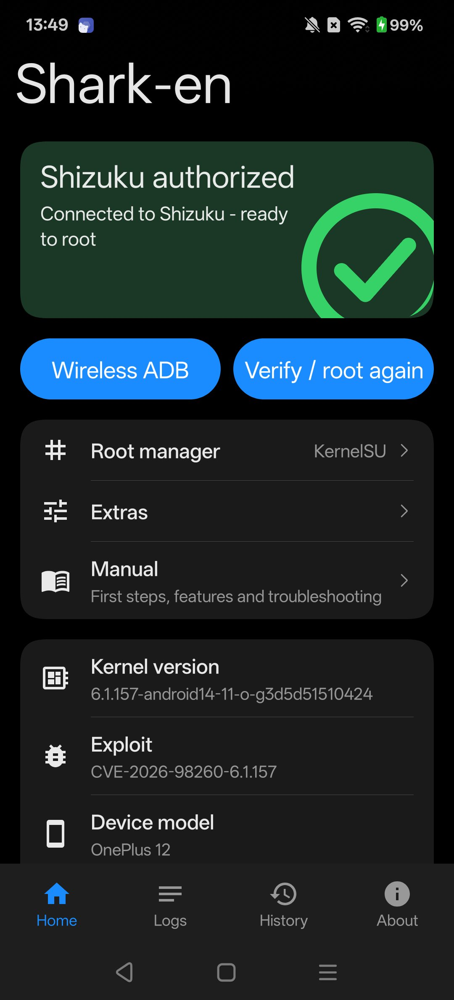
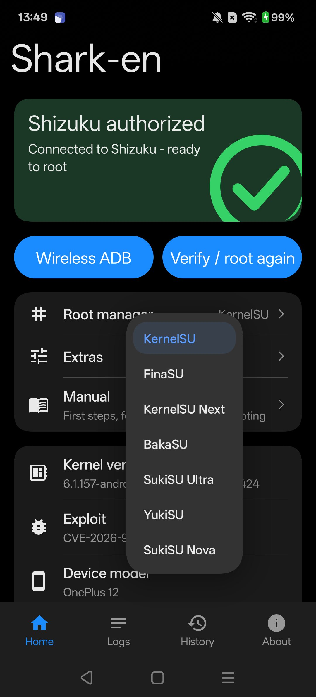
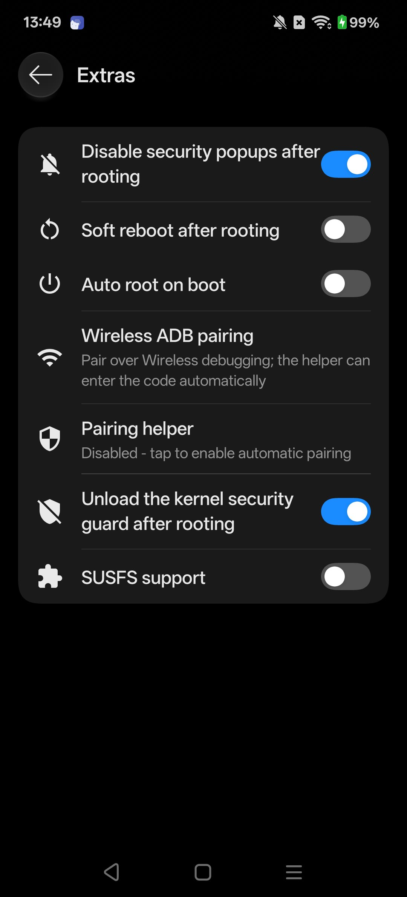
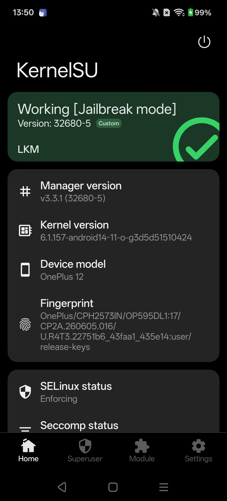

<h1 align="center"> Shark</h1>

<p align="center"><b>One-tap temporary root and manager-switching tool for multiple Android devices</b></p>

<p align="center">
  <a href="https://github.com/kpgc10kai/Shark/releases"></a>
  <a href="LICENSE"></a>
  
  
  
  
  <a href="https://github.com/Yunnijian/Shark"></a>
</p>

> **Unofficial English fork of [Yunnijian/Shark](https://github.com/Yunnijian/Shark).**
> Upstream removed its source repository in November 2026 and now publishes
> binaries and update notes in
> [Yunnijian/Shark-Releases](https://github.com/Yunnijian/Shark-Releases)
> (releases only, no source). This fork continues from the last synced source
> (v2.3.2) and follows that releases page: app features and new kernel profiles
> are ported from the published APKs, and each fork release states which
> upstream version it tracks. Source-level sync with upstream is no longer
> possible.
>
> No warranty. Only use it on devices you own, and read
> [Switching between the upstream and this fork](#switching-between-the-upstream-and-this-fork)
> before installing.

Shark supports OnePlus, OPPO, Realme, and other devices, with no BL unlock
required; all you need to begin is adb shell. Through Stellar or Shizuku, the app
drives the on-device exploit, gains temporary kernel privileges, then loads the LKM
for the selected manager, ultimately providing a KernelSU, KernelSU-Next, BakaSU,
SukiSU Ultra, SukiSU Nova, YukiSU, or FinaSU root environment.

## Interface

<table align="center">
  <tr>
    <td align="center"><br><sub><b>Home</b></sub></td>
    <td align="center"><br><sub><b>ROOT Manager</b></sub></td>
    <td align="center"><br><sub><b>Extras</b></sub></td>
  </tr>
  <tr>
    <td align="center"><br><sub><b>KernelSU</b></sub></td>
    <td align="center"><br><sub><b>BakaSU</b></sub></td>
    <td align="center"><br><sub><b>SukiSU Ultra</b></sub></td>
  </tr>
</table>

## Supported devices

| Device | System | Full kernel version |
| --- | --- | --- |
| OnePlus 16 (PYB110) | ColorOS 17 | `6.18.21-android17-5-gf957accaf563-ab15926176-4k`<br>`6.18.21-android17-5-g7fcbffcad3e1-ab16353812-4k` |
| OnePlus 15 (PLK110) | ColorOS 17 | `6.12.69-android16-6-g242e1a07f878-ab15865446-4k`<br>`6.12.69-android16-6-g5fd39602326e-ab16372235-4k` |
| OnePlus 15T (PLZ110) | ColorOS 17 | `6.12.69-android16-6-g242e1a07f878-ab15865446-4k`<br>`6.12.69-android16-6-g5fd39602326e-ab16372235-4k` |
| OnePlus Ace7 Pro (PMS110) | ColorOS 17 | `6.12.69-android16-6-g242e1a07f878-ab15865446-4k`<br>`6.12.69-android16-6-g5fd39602326e-ab16372235-4k` |
| OnePlus Ace7 (PYF110) | ColorOS 17 | `6.12.69-android16-6-g242e1a07f878-ab15865446-4k`<br>`6.12.69-android16-6-g5fd39602326e-ab16372235-4k` |
| OnePlus Ace6T (PLR110) | ColorOS 17 | `6.12.69-android16-6-g242e1a07f878-ab15865446-4k`<br>`6.12.69-android16-6-g5fd39602326e-ab16372235-4k`<br>`6.12.38-android16-5-g844001fb8721-ab14552068-4k` |
| OnePlus Ace6 Ultra (PMB110) | ColorOS 17 | `6.12.69-android16-6-g242e1a07f878-ab15865446-4k`<br>`6.12.69-android16-6-g5fd39602326e-ab16372235-4k` |
| OnePlus Ace6 (PLQ110) | ColorOS 17 | `6.6.118-android15-8-g9bc34d5b0c79-abogki537459655-4k`<br>`6.6.118-android15-8-gb1422e39c313-abogki552867473-4k` |
| OnePlus Ace5 Pro (PKR110) | ColorOS 17 | `6.6.118-android15-8-g9bc34d5b0c79-abogki537459655-4k` |
| OnePlus Pad3 Pro (OPD2513) | ColorOS 16/17 | `6.12.69-android16-6-g242e1a07f878-ab15865446-4k`<br>`6.12.69-android16-6-g5fd39602326e-ab16372235-4k`<br>`6.12.58-android16-6-g7704a1ae279b-ab15213644-4k` |
| OnePlus Pad2 Pro (OPD2413) | ColorOS 17 | `6.6.118-android15-8-gc4127a25dcf3-ab15863337-4k` |
| OPPO Find X9 Ultra (PMA110) | ColorOS 17 | `6.12.69-android16-6-g242e1a07f878-ab15865446-4k`<br>`6.12.69-android16-6-g5fd39602326e-ab16372235-4k` |
| OPPO Find X9 Pro (PLG110) | ColorOS 17 | `6.12.69-android16-6-g242e1a07f878-ab15865446-4k`<br>`6.12.69-android16-6-g5fd39602326e-ab16372235-4k` |
| OPPO Find X9 (PLJ110) | ColorOS 17 | `6.12.69-android16-6-g242e1a07f878-ab15865446-4k`<br>`6.12.69-android16-6-g5fd39602326e-ab16372235-4k` |
| OPPO Find X9s Pro (PME110EX) | ColorOS 17 | `6.12.69-android16-6-g242e1a07f878-ab15865446-4k`<br>`6.12.69-android16-6-g5fd39602326e-ab16372235-4k` |
| OPPO Find X10 (PMX110) | ColorOS 17 | `6.12.69-android16-6-g242e1a07f878-ab15865446-4k`<br>`6.12.69-android16-6-g5fd39602326e-ab16372235-4k` |
| OPPO Find X8 Ultra (PKJ110) | ColorOS 17 | `6.6.118-android15-8-g9bc34d5b0c79-abogki537459655-4k` |
| OPPO Find N5 (PKH110) | ColorOS 17 | `6.6.118-android15-8-gc4127a25dcf3-ab15863337-4k` |
| OPPO Pad Mini (OPD2515) | ColorOS 16/17 | `6.12.69-android16-6-g242e1a07f878-ab15865446-4k`<br>`6.12.69-android16-6-g5fd39602326e-ab16372235-4k`<br>`6.12.58-android16-6-g7704a1ae279b-ab15213644-4k` |
| OPPO Pad 5 Pro (OPD2511) | ColorOS 17 | `6.12.69-android16-6-g242e1a07f878-ab15865446-4k`<br>`6.12.69-android16-6-g5fd39602326e-ab16372235-4k` |
| OPPO Pad4 Pro (OPD2409) | ColorOS 17 | `6.6.118-android15-8-gc4127a25dcf3-ab15863337-4k` |
| Realme GT8 Pro (RMX5200) | ColorOS 17 | `6.12.69-android16-6-g242e1a07f878-ab15865446-4k`<br>`6.12.69-android16-6-g5fd39602326e-ab16372235-4k` |
| Realme GT8 (RMX6699) | ColorOS 17 | `6.6.118-android15-8-g9bc34d5b0c79-abogki537459655-4k` |
| OPPO K13 Turbo Pro (PLE110) | ColorOS 17 | `6.6.118-android15-8-g9bc34d5b0c79-abogki537459655-4k` |
| OPPO K15 Pro+ (PMG110) | ColorOS 17 | `6.6.118-android15-8-g9bc34d5b0c79-abogki537459655-4k` |
| Realme Neo8 (RMX8899) | ColorOS 16/17 | `6.12.38-android16-5-g844001fb8721-ab14552068-4k`<br>`6.12.69-android16-6-g242e1a07f878-ab15865446-4k`<br>`6.12.69-android16-6-g5fd39602326e-ab16372235-4k` |
| Xiaomi 18 Pro (M610BB) | HyperOS 4 / Android 17 | `6.18.21-android17-5-g1d099fcb35e0-abogki540753930-4k` |
| Xiaomi 18 Fold (lhasa) | HyperOS 4 / Android 17 | `6.18.21-android17-5-g805aa6adea19-abogki576585092-4k` |
| Xiaomi Pad 7S Pro (violin) | HyperOS 4 / Android 17 | `6.18.21-android17-5-g284297031c53-abogki553682993-4k` |
| Xiaomi Pad 9 Pro Max (yingtian) | HyperOS 4 / Android 17 | `6.18.21-android17-5-g805aa6adea19-abogki565292102-4k` |
| HONOR 600 (VKJ-NX9) | MagicOS 11 / Android 17 | `6.6.118-android15-8-gc901ea41aa32-ab15981388-4k` |

> OPPO K15 Pro+ working report: [@nakajimegame](https://x.com/nakajimegame/status/2124641337920348587).
> HONOR 600 (VKJ-NX9) working report: [ports/honor600-66118/README.md](ports/honor600-66118/README.md), tested on-device by [@Windroid234](https://github.com/Windroid234).
> The HONOR 600 port targets `experimental/shellserver`; after device verification it can be cherry-picked to `main`.

## Supported managers

Seven options are supported: KernelSU, KernelSU-Next, BakaSU, SukiSU Ultra, SukiSU Nova, YukiSU, and FinaSU.

Manager APKs are not distributed with Shark. Normal mode uses the `ksud` inside the
installed manager APK, so **install the manager you intend to use first**.

## What it can do

- **One-tap temporary root**: After opening the app, no manual exploit selection is
  needed; it uses `uname -r` to automatically match one of five chains: 6.18.21 /
  6.12.69 / 6.12.38 / 6.12.58 / 6.6.118. A single tap on “One-tap
  Jailbreak” completes privilege escalation, `ksud late-load`, module installation,
  and manager launch. Temporary root disappears after a reboot; just run it again on
  the next boot.
- **Wireless ADB pairing, no PC**: Pair over Android's Wireless debugging and run
  the root flow on the loopback ADB connection. With the optional accessibility
  helper enabled, Shark reads the six-digit pairing code from Settings and
  submits it automatically; otherwise the code can be entered from the pairing
  notification.
- **Wired ADB activation**: Connect USB and run `tools/wired-adb.sh` to start
  the privileged shell through ADB. Shark detects it as the Shizuku backend, so
  no Wireless debugging pairing is required.
- **Auto root on boot**: When enabled, the one-tap flow runs after boot and the
  result is shown in the log. The app asks for the "Display over other apps"
  permission so it can start from the background; allow Shark to auto-start in
  your device's battery/settings screen, or it cannot run after a reboot. If the
  previous automatic attempt never finished (a reboot during the flow), the
  option disables itself to avoid a loop.
- **Seven manager choices**: Pick KernelSU, KernelSU-Next, BakaSU, SukiSU Ultra, SukiSU Nova, YukiSU, or
  FinaSU directly from the ROOT Manager dropdown. The app is not tied to a single
  manager; the manager APK must be installed separately, and normal mode uses the
  `ksud` and LKM from that APK.
- **Hot manager switching**: Supported on 6.18 and 6.12. On the first clean boot,
  select `Dynamic Switching` to load the universal KSU LKM (initially KernelSU);
  afterward, choose the target manager under “Hot Manager Switching” in Extras.
  Switching synchronizes the version number, feature, private ioctl, and primary manager,
  and automatically reopens the target manager; no reboot or re-exploitation is
  required.
- **Extras**: On 6.18, a VFS provider can be loaded; on 6.12, SUSFS can be
  loaded. Other toggles suppress anti-root dialogs, perform a soft reboot after
  jailbreaking, and unload kernel security protections. Enable them as needed; a
  failure in one item does not affect root that is already active.
- **Logs and history**: Runtime logs scroll in real time. Each jailbreak saves a
  complete log to the History page, where it can be viewed, deleted, or swiped left
  to export and share, making it easier to troubleshoot failures or keep records.
- **Online updates**: Gitee Releases is checked at startup, falling back to GitHub if
  that fails. When a new version is found, it is downloaded in-app, its SHA-256 and
  APK signature are verified, and it is then handed to the system installer.
- **Droidspaces support**: On 6.18, the latest `droidspaces_lkm` module can be
  fetched with one tap and saved to `Download/Shark/`, after which it can be flashed
  in the KernelSU manager; the app does not bundle this module.

## Two root methods

### Normal mode

Choose a manager in ROOT Manager; the app uses the `ksud` bundled with that
manager's APK to load its own LKM. This is the manager's native root environment.

In normal mode, changing managers still requires a reboot.

### Extended mode

Select `Dynamic Switching` in ROOT Manager. The app uses the bundled
`libksud_universal.so` to load the universal KSU LKM; the initial manager is KernelSU.

After loading completes, “Hot Manager Switching” appears in Extras: open the
dropdown and choose the target manager; the app applies the switch and automatically
reopens the target manager. Switching only changes the manager profile in the kernel;
it does not uninstall modules or reboot.

The universal KO and stock KSU share the same name and hooks, so the first load must
happen on a clean boot with no KSU loaded; hot replacement is not possible once
`kernelsu` is loaded.

## Usage

1. Install the manager APK you want to use. If you plan to use Dynamic Switching,
   installing all five is recommended.
2. Start Stellar or Shizuku and grant access to Shark.
3. Select a normal manager or `Dynamic Switching` in the ROOT Manager dropdown.
4. Enable the Extras you need.
5. Tap “One-tap Jailbreak” and wait for `DONE` to appear in the logs.
6. In normal mode, open the manager and grant root; with Dynamic Switching, select
   the target manager in Extras, and the app switches to it and opens it automatically.

### Wireless ADB pairing

1. Enable **Wireless debugging** in Developer options.
2. Tap **Wireless ADB** in Shark. If the accessibility prompt appears, open
   Settings and enable **Shark pairing helper**.
3. In Settings, tap **Pair device with pairing code** and keep the dialog open.
4. The helper reads the six-digit code and submits it automatically. If the helper
   is off or the code cannot be read, expand the **Pairing service found**
   notification and enter the code there.
5. Wait for Shark to return and show **Wireless ADB authorized**. Pairing
   notifications are cleared on success.

The helper only observes `com.android.settings`; it does not read other apps or
open a network port.

### Wired ADB activation

When USB debugging is available, a PC can start the privileged shell directly;
no Wireless debugging pairing is needed.

1. Enable USB debugging and authorize the PC.
2. Keep Shark installed (the app can be in the background).
3. From this repository, run:

```bash
tools/wired-adb.sh
```

The script starts `ShellServer` as the shell user through `app_process`. Shark
detects the Shizuku-compatible binder and shows **Shizuku authorized**; the
normal One-click root flow then works over the wired connection.

To run it manually:

```bash
APK=$(adb shell pm path com.shark.kty | sed -n 's/^package://p' | tr -d '\r')
adb shell "CLASSPATH='$APK' setsid app_process /system/bin \
  --nice-name=shark_shell com.shark.kty.shell.ShellServer \
  </dev/null >/dev/null 2>&1 &"
```

The shell server is a normal shell process; it does not write partitions. The
watchdog keeps it alive until the device reboots.

### Experimental builds

Experimental APKs use a separate versionCode (`9001`, `9002`, ...) so they can
update over each other, but a public release (`1036`, ...) cannot be installed
over an experimental build. Uninstall the experimental APK before switching to
a public release. The public update path from `2.5.1-en.2` (`1035`) to
`2.5.1-en.3` (`1036`) is unaffected.

## Project structure

Shark consists of the Android app, the on-device exploit runner, and optional kernel modules.

```text
Shark/
├── app/                         Android app (Gradle project)
│   ├── app/src/main/java/com/shark/kty/
│   │   ├── MainActivity.kt      Four tabs, flow control, manager and Extras state
│   │   ├── UpdateChecker.kt     Gitee / GitHub update checks
│   │   ├── HistoryStore.kt      Log persistence, history records
│   │   └── DroidspacesModule.kt Droidspaces module download
│   ├── app/src/main/jniLibs/arm64-v8a/
│   │   ├── libk61821.so         6.18.21 runner
│   │   ├── libk61269.so         6.12.69 runner
│   │   ├── libk61238.so         6.12.38 runner
│   │   ├── libk61258.so         6.12.58 runner
│   │   ├── libk66118.so         6.6.118 runner
│   │   ├── libksud_universal.so Dual-KMI universal loader
│   │   ├── libsusfs_guard_lkm.so
│   │   ├── libsusfs_guard_lkm_612.so
│   │   └── libhybridmount.so
│   ├── app/src/main/assets/     manual.md, licenses, donation QR code
│   └── gradle/, keystore/
├── exploit/
│   ├── rust-k61821/             6.18.21 Rust runner
│   ├── rust-kplant/             6.12 / 6.6 Rust runner (feature selects the K source file)
│   └── src/                     plant_core.inc + K<version>_plant.c (one per kernel)
├── lkm/
│   ├── susfs4ksu-lkm/           SUSFS guard source
│   ├── hybridmount/             VFS provider source
│   └── susfs-tools/             SUSFS rule tools
├── docs/screenshots/            README screenshots
├── ports/coloros-61269/         6.12.69 dual-OTA build notes and recovery tools
├── ports/pkj110-66118/          PKJ110 6.6.118 notes and verification records
├── ports/honor600-66118/        HONOR 600 6.6.118 notes and verification records
├── third_party/                 Third-party licenses and materials
├── NOTICE / LICENSE
└── README.md
```

**Module responsibilities**

- `app/`: Kotlin/Compose UI, Shizuku/Stellar calls, exploit chain selection,
  Extras toggles, logging, and online updates.
- `exploit/`: Rust single-entry runner and C plant, responsible for privilege
  escalation, fake cred, `ksud late-load`, and cleanup.
- `lkm/`: Source and build scripts for the SUSFS guard and Hybrid Mount VFS provider.
- `third_party/`: Full third-party license texts and reference materials.

**Tech stack**

- App: Kotlin, Jetpack Compose, COUI-Kit, Shizuku / Stellar API.
- Device side: Rust + C, Android NDK arm64.
- Kernel side: C / GPL-2.0 LKM; the universal KSU KO is in a separate project
  [KSU-Universal](https://github.com/Yunnijian/KSU-Universal).
- Build: Gradle Kotlin DSL, Cargo, Android SDK/NDK, Docker DDK.

## Building from source

App:

```bash
cd app
./gradlew :app:assembleRelease
```

On-device runner (one `libk<version>.so` per kernel, installed into jniLibs automatically):

```bash
export ANDROID_NDK_HOME=/path/to/ndk
./exploit/build-all.sh
```

You can also build a single target:

```bash
cd exploit/rust-kplant
cargo build --release --target aarch64-linux-android \
    --no-default-features --features k66118
```

Available features: `k61269`, `k61238`, `k61258`, `k66118`;
6.18.21 is built separately by `rust-k61821`.

The universal KO and dual-KMI loader are built in
[KSU-Universal](https://github.com/Yunnijian/KSU-Universal); Shark only bundles the
compiled `libksud_universal.so`.

## Switching between the upstream and this fork

This fork and the upstream build share the package name (`com.shark.kty`) but use
**different signing keys**, so Android refuses to update one over the other:

```
INSTALL_FAILED_UPDATE_INCOMPATIBLE
```

To switch in either direction:

1. Back up anything you care about.
2. Uninstall the current build.
3. Install the build you want from the matching releases page
   ([this fork](https://github.com/kpgc10kai/Shark/releases) or
   [upstream releases](https://github.com/Yunnijian/Shark-Releases)).

Uninstalling clears the app's settings, the selected manager and extras, and the
run history. Root is temporary anyway and disappears on reboot.

The older `com.pyb110.onekey` build is a separate application. It can stay
installed alongside this one, but settings and history are not migrated.

## Notes

- The first Dynamic Switching load requires a clean boot; afterward, switching
  managers does not require a reboot.
- Normal mode requires the corresponding manager APK to be installed first; ksud is
  not bundled with Shark.
- KPM is not enabled yet.
- CVE-2026-98260 is a race-condition UAF; any run can cause a kernel panic or reboot.
- Use only on your own devices, at your own risk.

## Sources and license

- Shark's own code is GPL-3.0; see `LICENSE`. Third-party components are listed in `NOTICE`.
- The universal KSU LKM is based on SukiSU Ultra, GPL-3.0.
- SUSFS guard and Hybrid Mount are GPL-2.0.
- The CVE-2026-98260 design references the public port by AzirX1337 (MIT).
- The UI uses COUI-Kit (MPL-2.0), and remote execution uses the Shizuku API (Apache-2.0).

## Release

- This fork: https://github.com/kpgc10kai/Shark/releases
- Upstream releases (binaries only, no source):
  https://github.com/Yunnijian/Shark-Releases
- Upstream source repository was removed in November 2026. This fork continues
  from the last synced source (v2.3.2, upstream versionCode 98) and tracks the
  upstream releases page.

### Release policy

- Only the **latest `en.N` of each version line** keeps downloadable assets
  (`2.5-en.14`, `2.4.1-en.3`, `2.3.2-en.1`, `2.2.3-en.1`, `2.2.1-en.1`, `2.1-en.4`).
- Superseded, broken or intermediate builds keep a notice page as a
  **pre-release** with the APK removed, so their old links still lead to
  https://github.com/kpgc10kai/Shark/releases/latest
- Only the latest build of each line carries downloadable assets.
- Archiving is scripted: `tools/archive-release.sh v2.5.1-en.2` removes the
  assets, marks the release as a pre-release, and leaves the latest-download
  notice.

### Update history

| Fork release | Upstream | Changes |
|---|---|---|
| `2.4.1-en.1` | 2.4 | Auto root on boot (English UI) |
| `2.4.1-en.2` | 2.4.1 | Device table entry for Xiaomi 18 Pro |
| `2.4.1-en.3` | 2.4.1 | `libk61821.so` rebuilt with the Xiaomi 18 Pro `6.18.21-g1d099` profile (offsets verified offline against the firmware) |
| `2.5-en.1` | 2.5 | Xiaomi 18 Fold / Pad 9 Pro Max `6.18.21-g805aa6adea19` profile added (**experimental**; values copied from upstream, not yet verified against the matching firmware) |
| `2.5-en.2` | 2.5 | **Wireless ADB pairing** (experimental): pair from Settings, auto-grant `WRITE_SECURE_SETTINGS`, then run the root flow over the paired loopback ADB connection — no PC or separate Stellar/Shizuku app |
| `2.5-en.3` | 2.5 | Wireless ADB polish: opens Developer options scrolled to/highlighting “Wireless debugging”, keeps discovery running until the pairing dialog appears, and returns to the app via `am start` after pairing |
| `2.5-en.4` | 2.5 | Home action split like upstream: left “Wireless debugging” button (activate/pair) and right root button |
| `2.5-en.5` | 2.5 | Shortened the left button to “Wireless ADB” and gave both buttons the same accent color |
| `2.5-en.6` | 2.5 | Equal 50:50 button widths and single-line labels |
| `2.5-en.7` | 2.5 | Status card follows the active backend (`Wireless ADB authorized` / `not authorized`) instead of a fixed Stellar label |
| `2.5-en.8` | 2.5 | Fixed the wireless backend: one ADB connection per command, so the exploit no longer exits immediately with `-1`; translated the ported ADB log/error strings to English |
| `2.5-en.9` | 2.5 | Stream the exploit output into the log live; restore ftrace (`tracing_on=0`, `buffer_size_kb=1`) after a successful run; document the `EXIT=13` system-trace workaround |
| `2.5-en.10` | 2.5 | ftrace restore no longer blocks the flow on a manager root prompt (3 s timeout) |
| `2.5-en.11` | 2.5 | Stop reading as soon as the exploit exit marker arrives and add a 180 s watchdog, so a failed plant that parks a holder cannot hang the app |
| `2.5-en.12` | 2.5 | Manual: retry/reboot guidance for `FAIL=fake-cred` and repeated `EXIT=13` failures |
| `2.5-en.13` | 2.5 | Wireless backend now passes the environment and working directory, fixing `env missing ksud` on vivo/iQOO late-load |
| `2.5-en.14` | 2.5 | Manual: `FAIL=selinux` retry-versus-reboot guidance |
| `2.5.1-en.1` | 2.5.1 | Aligned with upstream 2.5.1: removed all vivo/iQOO support; added Xiaomi Xuanjie O1 (Pad 7S Pro) and O3 (Pad 9 Pro Max) 6.18.21 profiles |
| `2.5.1-en.2` | 2.5.1 | Fixed update checker: `2.5-en.14` no longer compares as newer than `2.5.1`, so the update dialog appears again |
| `2.5.1-en.3` | 2.5.1 | Issue #6: 6.6.118 KASLR low-21 alignment fix; automatic wireless pairing via the accessibility helper; paired-notification cleanup; supervisor timeout; manual/README updates |
| `2.5.1-en.4` | 2.5.1 | Wired ADB activation (`tools/wired-adb.sh`); pairing-helper status in Extras; bounded pairing timeouts; digest-first update checks; supervisor notification cleanup; `probe`/`--help` and no-arg diagnostics; archive tooling |
| `2.5.1-en.5` | 2.5.1 | SukiSU Nova manager support; robust pairing-code auto entry; KASLR single-scan fast path for aligned kernels; soft-reboot troubleshooting guidance |
| `2.5.1-en.6` | 2.5.1 | YukiSU manager support (`org.rouyashiki.yukisu`); seven manager choices; YukiSU late-load and universal-switch integration |

Each release stamps its own `2.5-en.N` version and is signed with the fork's
release key. Every release ships the signed APK together with its SHA-256 file.

### Planned / not yet ported

- **Pairing UI polish / English strings** — the current pairing flow uses the
  notification-based code entry inherited from Stellar; dedicated in-app screens
  and translations are still pending.
- **Device testing** — wireless ADB activation is experimental; verify on the
  target OnePlus devices before relying on it.
- Upstream Xiaomi 18 Fold profile remains experimental (see `2.5-en.1`).

Universal kernel release:

- https://github.com/Yunnijian/KSU-Universal/releases/tag/v1.1.0
- `ksu_universal-android16-6.12.ko`
- `ksu_universal-android17-6.18.ko`
- `ksud_universal`
